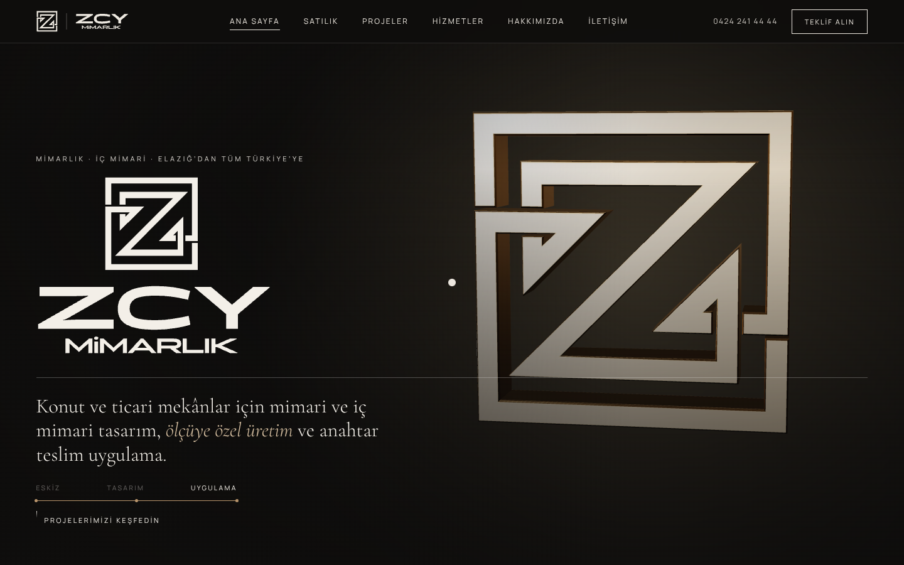
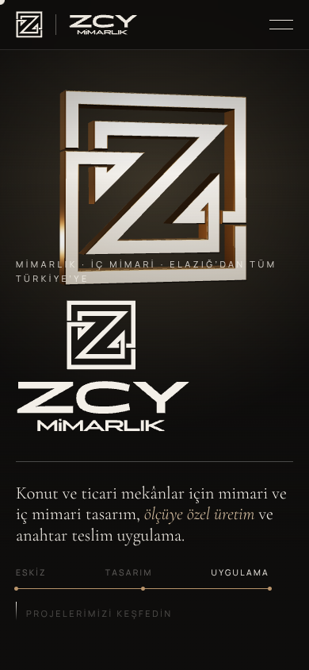
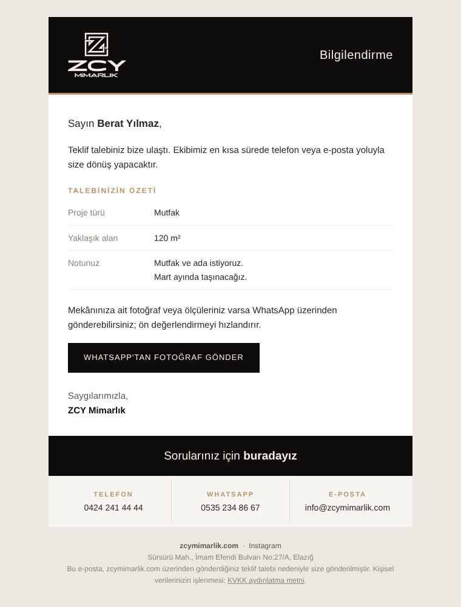
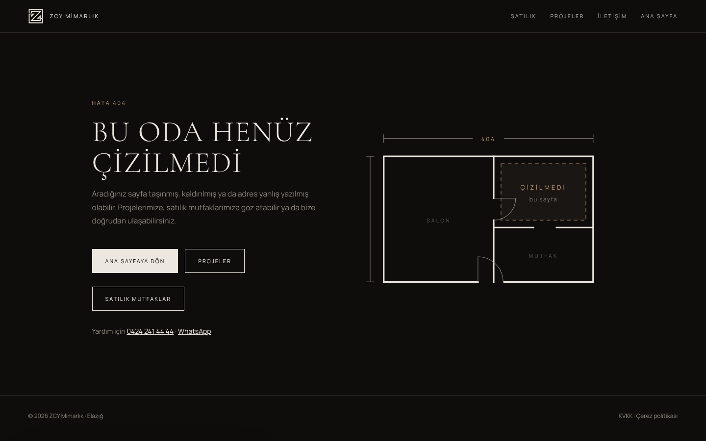

# ZCY Mimarlık — Kurumsal Web Sitesi

**Canlı site:** [zcymimarlik.com](https://zcymimarlik.com)

Elazığ merkezli mimarlık ve iç mimarlık firması ZCY Mimarlık (Vanucci Mutfak & Banyo yetkili satıcısı) için sıfırdan geliştirilmiş kurumsal web sitesi. Hazır tema ya da framework kullanılmadı: HTML, CSS, vanilla JavaScript, 3D sahneler için Three.js ve teklif formu için PHP.

*Corporate website for an architecture and interior design firm in Elazığ, Turkey. Built from scratch with HTML, CSS, vanilla JS, Three.js and a small PHP mail handler. PageSpeed 100 on mobile and desktop.*

## Öne çıkanlar

- **Kaydırmayla çalışan 3D sahneler:** Giriş ekranında kaydırdıkça çizilen 3D ZCY logosu, kendini kuran açık ve koyu mutfak sahneleri. Three.js ile yazıldı, esbuild ile tek dosyaya paketlendi. Görünür olmadıkça yüklenmiyor, kaydırırken çözünürlüğü dinamik olarak ayarlıyor, ekran kartı olmayan cihazlarda fotoğraflı sürüme geçiyor.
- **Performans:** Google PageSpeed Insights'ta mobil ve masaüstünde Performans, Erişilebilirlik, En İyi Uygulamalar ve SEO'nun dördü de 100. Görseller WebP ve boyuta göre ayrı sürümlerle (`srcset`) sunuluyor, script'ler ertelenerek yükleniyor, statik dosyalar sürüm etiketiyle 1 yıl önbellekte tutuluyor.
- **Teklif formu:** PHP ile gerçek posta hesabı üzerinden SMTP gönderimi (SPF, DKIM ve DMARC'tan geçiyor). Firmaya bildirim, müşteriye kurumsal tasarımlı otomatik bilgilendirme maili gidiyor. Spam koruması: tuzak alan, minimum doldurma süresi, saatlik sınır ve link filtresi. Form verileri sunucuda saklanmıyor.
- **KVKK uyumu:** Çerez onayı verilmeden hiçbir analiz ya da reklam kodu yüklenmiyor. Ayrı KVKK aydınlatma metni, Gizlilik politikası, Kullanım koşulları ve Çerez politikası sayfaları var.
- **Güvenlik:** Satır içi script'e izin vermeyen Content-Security-Policy, HSTS, X-Frame-Options, nosniff, Referrer-Policy ve Permissions-Policy. Gizli bilgiler kodda değil, sunucuda web'den erişilemeyen bir ayar dosyasında.
- **SEO:** Schema.org yapılandırılmış veri (LocalBusiness, FAQPage), site haritası, Search Console ve Google İşletme Profili entegrasyonu.
- **Detaylar:** Fotoğraf galerisi ve küçük resim şeridi, mobilde sayfa yakınlaştırmayı kapatıp sadece fotoğraflarda açık bırakma, kat planı animasyonlu 404 sayfası.

  
  

## Kaynak kod

Projenin kaynak kodu gizli bir depoda tutulmaktadır. Kodu incelemek isteyen işverenler ve iş ortakları için talep üzerine erişim verilebilir; GitHub profilimdeki iletişim bilgilerinden ulaşabilirsiniz.

Proje kapsamında yapılanlar:

- Arayüz: HTML, CSS ve vanilla JavaScript (framework yok), mobil öncelikli ve dokunmatik cihazlar için ayrı iyileştirmeler
- 3D: Three.js ile kaydırmaya bağlı logo ve mutfak sahneleri, esbuild ile tek dosyalık ES modülü
- Sunucu: PHP 8.3 teklif formu, SMTP gönderimi, Apache/LiteSpeed `.htaccess` ile güvenlik başlıkları ve önbellek kuralları
- Yayın ve bakım: Natro cPanel hosting, SSL, e-posta (SPF/DKIM/DMARC), Google Search Console ve İşletme Profili kurulumu

## Teknolojiler

HTML5 · CSS3 · Vanilla JavaScript · Three.js · esbuild · PHP 8.3 · Apache/LiteSpeed (.htaccess) · Lenis (yumuşak kaydırma)

## Haklar

Bu depo yalnızca proje tanıtımı içindir. Proje, Berat Yılmaz tarafından ZCY Mimarlık için geliştirilmiştir. Tüm hakları saklıdır. Fotoğraflar, logolar ve metinler ZCY Mimarlık'a; Vanucci, Smeg ve Penta adları ve görselleri ilgili marka sahiplerine aittir. İzinsiz kullanılamaz.

---

Geliştiren: [Berat Yılmaz](https://github.com/beratyyilmaz)
